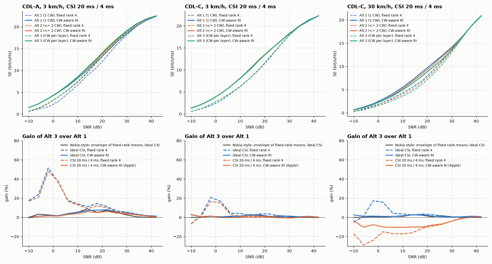
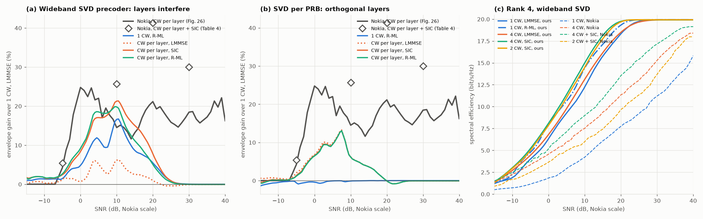

# Codeword-to-layer mapping: why Apple R1-2608231 and Nokia R1-2607066 disagree

Two RAN1 #126bis contributions disagree on multi-codeword PDSCH for ranks 1–4.

| | Nokia R1-2607066 | Apple R1-2608231 |
|---|---|---|
| Proposal | up to 4 CW, one per layer, from rank 2 | 1 CW for ranks 1–4 (Alt 1), 2 CW for ranks 5–8 |
| Link level | one CW per layer beats one CW by 14–25 % at 10–30 dB (Table 4); with SIC by 26–41 % | at fixed rank 4 large gains, but with codeword-aware rank adaptation within a few %; 0 at 30 km/h |
| System level | 4 CW + SIC: +12 / +21 / +28 % mean user throughput at three loads (Fig. 29) | Alt 2 −4 to −12 %, Alt 3 −8 to −18 % user SE at 30 % and 50 % resource utilisation (Table 2) |

> **Note (Oct 2026).** The CDL-C results here were computed before six CDL-C clusters' angles were corrected to TR 38.901 (CDL-A was already correct). Re-running the CDL-C 3 km/h case with the corrected tables and the same seeds (8 drops) changes SE by at most 2.5 % at any point and the mean Alt 3 vs Alt 1 gain by at most 0.2 percentage points, so the conclusions stand. Re-run the script to refresh the numbers.

This note puts the two evaluations side by side and checks each difference with the simulators in this repository (nrdlsim) and in NR_DL_SLS. The results are in `results/cw2lm_apple.json` (link level, Apple's set-up) and in NR_DL_SLS `results/cw2lm_sls_probe.json` (system level). The comparison with Nokia's own set-up is in [cw2lm-nokia.md](cw2lm-nokia.md).

```bash
python examples/cw2lm_apple.py --drops 32               # ~17 min on 4 cores, LMMSE
python examples/cw2lm_apple.py --receivers mmse,sic,rml --drops 16 --cases CDL-A:3,CDL-C:30 \
    --out results/cw2lm_apple_rx.json                    # SIC and R-ML
# in NR_DL_SLS:
python examples/cw2lm_sls_probe.py --drops 2 --slots 160 --jobs 2
```

## 1. The two evaluations differ in almost every assumption

**Link level**

| | Nokia (Annex B, Table 11) | Apple (Table 2-1) |
|---|---|---|
| Carrier | 3.5 GHz, 30 kHz, 40 MHz | 4 GHz, 30 kHz, 20 MHz |
| Channel | CDL-A, 100 ns, 3 km/h | CDL-A, CDL-C, 100 ns; 3 km/h and 30 km/h |
| gNB | 64 TXRU, (12,8,2;4,8) | 32 TXRU, (2,8,2;2,8) |
| UE | 8 Rx, directive, no blockage | 4 Rx handheld, elements [1,3,5,7], no blockage |
| Precoder | not stated | wideband SVD |
| CSI | not stated ("AMC") | CSI-RS every 20 ms, 4 ms delay; per-codeword CQI; OLLA; HARQ |
| Rank | fixed 1–4; Table 4 is the envelope over fixed ranks | fixed 4, and rank adaptation per report that knows the codeword split |
| Receiver | MMSE and MMSE-SIC | LMMSE |

**System level**

| | Nokia (Table 12) | Apple (Table 2-2) |
|---|---|---|
| Scenario | UMa, ISD 500 m, 4 GHz, 100 MHz TDD | dense urban, ISD 200 m, 7 GHz, 20 MHz TDD |
| gNB | 64 TXRU, 54.2 dBm | 256 TXRU, 44 dBm |
| UE | directive (1,3,5,7) with hand and head blockage for 90 % of UEs | 4 Rx cross-pol |
| CSI | ideal precoding, ideal channel and interference estimation | eType-II (combination 6), 20 ms, 4 ms delay, realistic estimation |
| Receiver | MMSE-IRC + SIC | L-MMSE |
| Traffic | FTP 3, 500 kB, three loads | FTP 1, 30 % and 50 % resource utilisation |
| Link adaptation | 10 % BLER target | OLLA per codeword; HARQ refills an ACKed codeword |

## 2. Apple's link-level set-up in nrdlsim

`examples/cw2lm_apple.py` runs Apple's Table 2-1 set-up:

- 4 GHz, 51 PRB, 32T (2,8,2;2,8), 0.5 / 0.8 λ.
- 4-Rx handset: elements 1, 3, 5, 7 of `ut_handset_array`.
- Wideband SVD precoder and LMMSE with a DM-RS channel estimate.
- Per-codeword CQI (highest MCS with BLER ≤ 10 %) and OLLA per codeword; no HARQ.
- 32 drops × 400 slots (200 ms) per case.

It switches on Apple's assumptions one at a time:

- CSI: measured in the transmission slot ("ideal") or every 20 ms with a 4 ms delay and Doppler ("realistic", Apple).
- Rank: fixed 4, or chosen per report to maximise Σ_CW TBS·(1−BLER) for that mapping ("CW-aware RI", Apple).
- Nokia's metric on the same drops: ideal CSI, genie MCS per slot, envelope over the fixed-rank mean curves.

Gain of Alt 3 (one CW per layer) over Alt 1 (one CW) at −2 / 6 / 14 / 22 / 30 dB:

| CDL-A, 3 km/h | −2 dB | 6 dB | 14 dB | 22 dB | 30 dB |
|---|---|---|---|---|---|
| ideal CSI, fixed rank 4 | +52 % | +18 % | +11 % | +11 % | +6 % |
| CSI 20 ms / 4 ms, fixed rank 4 (Apple Fig. 2-2a) | +48 % | +17 % | +9 % | +10 % | +4 % |
| Nokia's metric: envelope of fixed-rank means, ideal CSI | +2 % | +4 % | +9 % | +7 % | +3 % |
| ideal CSI, CW-aware RI | +2 % | +4 % | +7 % | +8 % | +5 % |
| CSI 20 ms / 4 ms, CW-aware RI (Apple Fig. 2-3) | +2 % | +3 % | +6 % | +6 % | +4 % |

| CDL-C | −2 dB | 6 dB | 14 dB | 22 dB | 30 dB |
|---|---|---|---|---|---|
| 3 km/h, CSI 20 ms / 4 ms, fixed rank 4 (Apple Fig. 2-2b) | +18 % | +2 % | 0 % | +1 % | 0 % |
| 3 km/h, CSI 20 ms / 4 ms, CW-aware RI (Apple Fig. 2-4a) | +2 % | 0 % | +2 % | 0 % | 0 % |
| 30 km/h, CSI 20 ms / 4 ms, CW-aware RI (Apple Fig. 2-4b) | −8 % | −10 % | −9 % | −8 % | −5 % |



These numbers reproduce Apple's observations 2-11a and 2-11b:

- At fixed rank 4, Alt 3 gains a lot on CDL-A and little on CDL-C. The gain grows with layer imbalance.
- With codeword-aware rank adaptation the gain falls to a few percent.

Apple's Fig. 2-3 (CDL-A, rank adaptation) shows 6–7 % at 10–18 dB; this simulator gives 6 % at 14 dB.

**At 30 km/h, one codeword per layer loses 5–10 %.** OLLA holds the first-transmission BLER at 10–11 % for every mapping, so the loss is not extra block errors. It is the larger MCS back-off each per-layer codeword needs. A 4-layer codeword averages the SINR fluctuation of its layers, while a per-layer codeword sees each layer's fluctuation in full, so its OLLA settles lower. Apple's curves at 30 km/h coincide with each other at about 7.5 bit/s/Hz. In this simulator, the LMMSE with a fresh DM-RS estimate keeps the aged layers separable at high SNR, so the curves do not saturate. The direction is the same, however: more codewords do not help once CSI ages.

**Fixed rank 4 is what makes the large numbers.** On Apple's channel, Nokia's metric (envelope of fixed-rank averages) gives 2–9 %, close to Apple's 2–6 % with rank adaptation. A single codeword at fixed rank 4 must carry layers that rank adaptation would drop. Per-report rank adaptation takes a further 1–3 points off the envelope.

## 3. System level: what more codewords could gain in a running system

NR_DL_SLS `examples/cw2lm_sls_probe.py` runs the full-buffer SU-MIMO system unchanged, with one codeword. The scenario is the Dense Urban-eMBB A preset: ISD 200 m, 4 GHz, 32T4R, 570 UTs, 80 % indoor at 3 km/h and 20 % in car at 30 km/h. Inside the run it measures two things:

- **The CSI-stage potential (Apple's check).** At every CSI report, for each mapping, the rank that maximises Σ_CW TBS·(1−BLER) at the per-codeword CQI MCS, and the resulting expected bits.
- **The per-layer SINR error.** Each first transmission's per-layer SINR, which uses the report's precoder on the current channel and interference, minus the SINR the report predicted.

| | eType-II, 20 ms / 4 ms (Apple-like) | wideband SVD, 2 ms, no delay (Nokia-like) |
|---|---|---|
| CSI-stage gain, CW-aware RI, Alt 2 / Alt 3 | **+0.8 % / +1.2 %** (Apple: +0.4 % / +1.6 %) | **+0.3 % / +0.5 %** |
| same at fixed rank 4 | +9.0 % / +9.7 % | +8.5 % / +9.0 % |
| reported rank 1 / 2 / 3 / 4 (Alt 3) | 1 / 72 / 24 / 4 % | 1 / 52 / 38 / 8 % |
| rank-2 per-layer SINR error, mean / std (dB), layer 1, layer 2 | −4.2 / 3.5, −2.6 / 3.5 | −2.7 / 3.3, −2.6 / 3.4 |
| rank-4 per-layer SINR error std (dB) | 4.0 / 3.9 / 4.0 / 4.1 | 3.2 / 3.2 / 3.3 / 3.2 |

Three things follow:

- **The system uses rank 2 most of the time.** At rank 2, Alt 2 and Alt 3 are the same mapping, and Alt 3 differs from Alt 2 only at ranks 3–4, about a quarter of the reports.
- **The potential is already about 1 % at the CSI stage.** This is what Apple found as well. At fixed rank 4 it would be 9–10 %, so the potential is set by rank adaptation, not by the codeword split. With near-ideal CSI (wideband SVD every 2 ms) it is even smaller, +0.5 %, because better CSI also improves the single codeword's rank choice.
- **Per-layer SINR prediction errors are large.** Under Apple-like CSI, each layer's SINR at transmission differs from the report with a standard deviation of 3.5–4 dB. Even with CSI 2 ms old and unquantised it is 3.2–3.4 dB, because the interference changes from slot to slot as the neighbours' PF decisions change their precoders. That is about the same as the median gap between the two layers at rank 2 (24.3 vs 20.3 dB). A per-layer MCS is chosen on a prediction whose error is as large as the imbalance it is meant to exploit. Each codeword's OLLA then has to absorb an error that a single codeword would average over its layers.

## 4. Receivers

nrdlsim now has two alternatives to the LMMSE receiver (`nrdlsim.receiver`):

- **Codeword-level MMSE-SIC** (`cancelled_sinr`, `link_abstraction.sic_amc`). Codewords are decoded in order, and a codeword is cancelled only after its CRC passes. The cancellation uses the channel estimate, so the estimation error stays as residual interference. The CQI of codeword k assumes that codewords 1..k−1 are cancelled, and the expected throughput includes error propagation. With one codeword, SIC is MMSE.
- **(R-)ML abstraction** (`rml_sinr_samples`). Each layer takes the MMSE-SIC chain-rule term of every detection order, averaged over all orders. The layers' mutual information then adds up to log2 det(I + HᴴH/N0), the joint (ML) mutual information for Gaussian inputs. The BICM capacity of each sample keeps every layer capped at its constellation.

  This models an ideal ML detector. A reduced-complexity implementation loses some of the gain, and the abstraction has not been calibrated against a bit-level R-ML detector here.

**Nokia's set-up** (CDL-A, 64T8R, ideal CSI; [cw2lm-nokia.md](cw2lm-nokia.md)). Envelope gain over 1 CW with LMMSE at −5 / 10 / 20 / 30 dB:

| Precoder | 1 CW, R-ML | CW per layer, LMMSE | CW per layer, SIC | CW per layer, R-ML |
|---|---|---|---|---|
| SVD per PRB (orthogonal layers) | 0 / 0 / 0 / 0 % | +2 / +6 / 0 / 0 % | +1 / +6 / 0 / 0 % | +1 / +6 / 0 / 0 % |
| wideband SVD (layers interfere) | +1 / **+17** / +5 / 0 % | +1 / +6 / +1 / 0 % | +2 / **+21** / +8 / 0 % | +3 / +20 / +5 / 0 % |
| Nokia (Table 4) | – | +2.6 / +14 / +25 / +20 % | +5.4 / +25.7 / +41.3 / +30 % | – |



**Apple's set-up** (CSI 20 ms / 4 ms, codeword-aware RI). Gain over Alt 1 with LMMSE at −2 / 6 / 14 / 22 / 30 dB:

| | Alt 1 (1 CW) | Alt 2 (≤ 2 CW) | Alt 3 (CW per layer) |
|---|---|---|---|
| CDL-A 3 km/h, LMMSE | 0 | +1 / +2 / +3 / +5 / +3 % | +1 / +2 / +5 / +7 / +4 % |
| CDL-A 3 km/h, SIC | 0 | +1 / +2 / +5 / +9 / +9 % | +1 / +2 / +8 / +14 / +12 % |
| CDL-A 3 km/h, R-ML | 0 / 0 / +3 / +7 / +8 % | +1 / +3 / +8 / +14 / +13 % | +1 / +3 / +10 / +15 / +12 % |
| CDL-C 30 km/h, LMMSE | 0 | −7 / −6 / −3 / −3 / −2 % | −7 / −9 / −8 / −8 / −4 % |
| CDL-C 30 km/h, SIC | 0 | −2 / +3 / +7 / +9 / +15 % | −6 / +4 / +9 / +17 / +28 % |
| CDL-C 30 km/h, R-ML | +9 / +29 / +36 / +41 / +34 % | +3 / +21 / +33 / +37 / +33 % | +2 / +15 / +26 / +32 / +30 % |

(16 drops × 400 slots; `results/cw2lm_apple_rx.json`.)

- **SIC and ML help only when the layers interfere.** With SVD precoding per PRB and ideal CSI the layers are orthogonal, and both receivers give exactly the LMMSE result. Nokia's MCW + SIC gain is 25.7 % against 14 % without SIC at 10 dB. That can only happen if Nokia's layers interfere, so Nokia's precoder is not per-PRB SVD. Part of the "layer imbalance" behind Nokia's MMSE curves is then inter-layer interference, which an MMSE receiver turns into per-layer SINR loss and which SIC removes.
- **With interfering layers, SIC roughly triples the multi-codeword gain**: wideband SVD gives +21 % at 10 dB against +6 % with LMMSE. That is close to Nokia's +25.7 %.
- **R-ML gives a single codeword most of that gain (+17 %), without a second codeword.** This is the old LTE result: SCW with ML detection performs close to MCW with SIC.
- **Ageing makes the layers interfere.** At 30 km/h the aged wideband precoder leaks between layers. One codeword per layer then loses 4–9 % with LMMSE but gains up to 28 % with SIC. A single codeword with R-ML gains 29–41 %, more than any multi-codeword option, because it keeps one OLLA loop over averaged layers.

## 5. Why the results differ

Both evaluations are internally consistent, and both are reproduced here in their own conditions. The difference comes from the conditions each one tests. In order of size:

1. **Rank adaptation.**
   - At fixed rank 4, one codeword per layer gains a lot because the single codeword is forced to carry layers that rank adaptation would drop: +48 % at −2 dB on CDL-A, and +9.7 % at the CSI stage in the system probe.
   - With per-report, codeword-aware rank adaptation (Apple), this falls to 2–6 % on CDL-A, about 0 % on CDL-C and about 1 % in the system.
   - Nokia's link-level Table 4 uses the envelope over fixed-rank averages. On Apple's channel that gives 2–9 %, close to rank adaptation. So rank adaptation explains Apple's own fixed-vs-adaptive gap, but not Nokia's 14–25 %.
2. **How much the layers differ, through the UE antenna, blockage and precoder.**
   - Nokia's gains need weak layers that stay weak. Their MMSE curves imply a second layer about 17 dB below the first, and their SIC gains show that the layers also interfere.
   - Nokia's SLS adds directive UE antennas and hand or head blockage on 90 % of the UEs, which both create imbalance.
   - Apple's LLS uses no blockage, and its SLS uses a 4-Rx cross-polarised UE.
   - In this simulator's CDL-A / CDL-C with handset UEs and per-PRB SVD, the layers are much more balanced (σ2² about 4 dB below σ1²), and the gain stays small. Nokia makes the same point themselves (Observation 36): the gain depends on how realistically the evaluation produces imbalance.
3. **The receiver baseline.**
   - Nokia's system-level gains (+12 to +28 %) are MCW *with SIC* against SCW with MMSE. Apple runs LMMSE for every alternative.
   - With interfering layers, SIC roughly triples the multi-codeword gain here. An R-ML receiver gives the single codeword most of the same gain, and with aged CSI more than any multi-codeword option.
   - So part of Nokia's system-level gain measures SIC against MMSE, not the codeword mapping. A like-for-like comparison is SCW + R-ML against MCW + SIC.
4. **CSI and interference realism.**
   - Nokia's SLS assumes ideal precoding and ideal channel and interference estimation.
   - Apple's uses eType-II with a 20 ms period and 4 ms delay, realistic estimation, and 20 % of the UEs at 30 km/h on 7 GHz.
   - A per-layer MCS can only exploit the imbalance it can predict. In the system probe the per-layer prediction error is 3.5–4 dB (std), about the same as the imbalance between the layers. At 30 km/h with LMMSE, one codeword per layer loses 5–10 % at link level, because each per-layer codeword's OLLA has to back off from that error by itself.
5. **Per-codeword overheads and traffic.** Apple's 20 MHz carrier, FTP 1 traffic and per-codeword OLLA loops, CRCs and TB segmentation favour one codeword. Nokia's 100 MHz carrier with FTP 3 at high load favours more codewords, and Nokia's gain grows with load. Apple's 7 GHz, 256T array puts many layers at the top MCS, where no mapping can gain.

**Conclusion.** Nokia shows what more codewords can gain when rank adaptation leaves imbalanced, interfering layers and SIC is available, under ideal CSI. Apple shows that with codeword-aware rank adaptation, realistic CSI and interference, and LMMSE, little imbalance is left that a per-layer MCS can track.

A comparison that settles the question needs, for each scheme:
- per-report, codeword-aware rank adaptation;
- realistic CSI (period, delay, codebook) and interference;
- the TR 38.901 V19 UE antenna and blockage models;
- the best receiver of each scheme: SCW + (R-)ML against MCW + SIC;
- reported statistics: rank distribution, per-layer SINR and imbalance (Nokia's Proposals 44–45), and the per-layer CQI error.

## Limitations

- The R-ML receiver is an ideal-ML abstraction. The SIC model assumes ideal reconstruction apart from the channel-estimation error.
- The link-level studies have no HARQ: a failed TB is lost.
- The system probe measures potential and CQI error. It does not run Alt 2 and Alt 3 end to end, and the system simulator has MMSE-IRC only.
- Apple's 7 GHz, 256T system and Nokia's UMa ISD 500 m, 100 MHz system were not simulated; Dense Urban A is the closest preset.
- The handset UE model is the assumed reconstruction of TR 38.901 V19.1.0 §7.3 described in [cw2lm-nokia.md](cw2lm-nokia.md).
