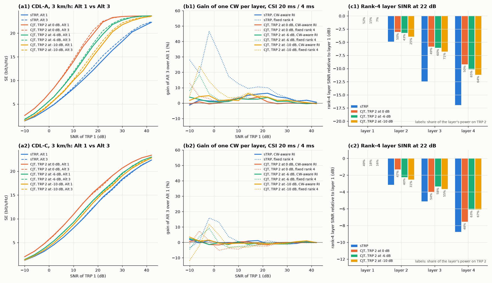

# Codeword-to-layer mapping with 2-TRP coherent joint transmission

Does multi-TRP coherent joint transmission (CJT) make more codewords worthwhile? The argument for it is that the layers of a joint precoder can come from TRPs of different strength. They would then be imbalanced, which is the condition under which one codeword per layer gains over NR's single codeword.

This study tests that argument in a deliberately simple 2-TRP case, using the link-level machinery of the Apple and Nokia studies ([cw2lm-apple.md](cw2lm-apple.md), [cw2lm-nokia.md](cw2lm-nokia.md)).

```bash
python examples/cw2lm_mtrp.py                                    # ~1 h on 4 cores
python examples/cw2lm_mtrp.py --models CDL-A --receivers mmse,sic --no-plot \
    --out results/cw2lm_mtrp_sic.json                            # with SIC
python examples/cw2lm_mtrp.py --models CDL-A --trp2-delay-ns 300 --no-plot \
    --out results/cw2lm_mtrp_delay300.json                       # TRP timing offset
```

## Set-up

| | |
|---|---|
| Each TRP | Apple R1-2608231's link-level set-up: 4 GHz, 51 PRB at 30 kHz (20 MHz), 32 ports (2,8,2;2,8), 38.901 element |
| UE | 4-Rx handset (elements 1, 3, 5, 7 of `ut_handset_array`), 3 km/h |
| Channel | CDL-A or CDL-C, DS 100 ns, independent per TRP. TRP 2 reaches the UE from the opposite side: link 2 is rotated by 180°, including UE orientation and travel direction. |
| TRP 2 | 0, −6 or −10 dB weaker than TRP 1; no timing or phase offset unless stated |
| Channel model | `nrdlsim.channel_models.MultiTRPChannel`, the two links stacked along the transmit ports |
| CJT precoder | Wideband SVD of the stacked 64-port channel. Each TRP's part is scaled to that TRP's full power (per-TRP power constraint), so CJT radiates twice the power of one TRP. |
| Single TRP (sTRP) | TRP 1 alone, wideband SVD, the same channel as TRP 1 in CJT |
| SNR | TRP 1's SNR per receive antenna |
| CSI | 'ideal' (measured in the slot) or 'realistic' (CSI-RS every 20 ms, 4 ms delay) |
| Rank | fixed 4, or per report the rank maximising Σ_CW TBS·(1−BLER) for the mapping (codeword-aware) |
| Link adaptation | per-codeword CQI (highest MCS with BLER ≤ 10 %) and OLLA; LMMSE receiver with a DM-RS estimate; no HARQ |
| Mappings | Alt 1: 1 CW for ranks 1–4. Alt 2: 2 CW for ranks 2–4. Alt 3: one CW per layer. |
| Statistics | 16 drops × 320 slots (80 warm-up) per scenario |

At every realistic report the study also records the rank-4 per-layer SINR and the share of each layer's transmit power that comes from TRP 2.

## Results



Gain of Alt 3 over Alt 1 at −2 / 6 / 14 / 22 / 30 dB, CSI 20 ms / 4 ms, codeword-aware rank:

| CDL-A | Alt 1 SE (bit/s/Hz) | Alt 3 vs Alt 1 | Alt 2 vs Alt 1 | Alt 1 CJT vs sTRP |
|---|---|---|---|---|
| sTRP | 3.5 / 6.5 / 10.2 / 14.3 / 18.3 | +1 / +2 / +5 / +6 / +3 % | +1 / +2 / +3 / +5 / +3 % | – |
| CJT, TRP 2 at 0 dB | 6.1 / 11.1 / 17.2 / 22.3 / 23.5 | −1 / +1 / +3 / +1 / 0 % | −1 / +2 / +2 / 0 / 0 % | +72 / +70 / +69 / +56 / +29 % |
| CJT, TRP 2 at −6 dB | 4.7 / 8.9 / 14.4 / 19.7 / 22.8 | +1 / +1 / +3 / +4 / +1 % | 0 / +1 / +1 / +3 / +1 % | +33 / +36 / +42 / +38 / +25 % |
| CJT, TRP 2 at −10 dB | 3.9 / 7.6 / 12.1 / 17.7 / 21.8 | +5 / +2 / +6 / +4 / +2 % | +5 / +3 / +5 / +3 / +1 % | +11 / +17 / +19 / +24 / +19 % |

| CDL-C | Alt 1 SE (bit/s/Hz) | Alt 3 vs Alt 1 | Alt 1 CJT vs sTRP |
|---|---|---|---|
| sTRP | 3.2 / 6.2 / 10.0 / 14.5 / 18.3 | 0 / −1 / 0 / −1 / −1 % | – |
| CJT, TRP 2 at 0 dB | 4.7 / 8.7 / 13.3 / 17.3 / 20.7 | −1 / −1 / +1 / −2 / 0 % | +50 / +40 / +32 / +19 / +13 % |
| CJT, TRP 2 at −6 dB | 3.8 / 7.2 / 11.6 / 15.9 / 19.5 | −1 / −1 / −1 / −1 / −1 % | +19 / +17 / +15 / +10 / +7 % |
| CJT, TRP 2 at −10 dB | 3.4 / 6.7 / 11.0 / 15.4 / 19.0 | +1 / −1 / 0 / −1 / −1 % | +7 / +9 / +9 / +6 / +4 % |

At fixed rank 4 (CDL-A), Alt 3 gains +46 / +17 / +10 / +10 / +4 % for one TRP but only +3 / +2 / +3 / +1 / 0 % for CJT at 0 dB.

Rank-4 per-layer SINR at the reports, 22 dB, relative to layer 1, with each layer's power share on TRP 2:

| CDL-A | layer 2 | layer 3 | layer 4 |
|---|---|---|---|
| sTRP | −4.9 dB | −12.5 dB | −17.0 dB |
| CJT, 0 dB | −3.1 dB (50 %) | −5.8 dB (49 %) | −9.2 dB (50 %) |
| CJT, −6 dB | −3.2 dB (43 %) | −6.1 dB (60 %) | −10.2 dB (65 %) |
| CJT, −10 dB | −3.9 dB (25 %) | −6.7 dB (71 %) | −11.2 dB (64 %) |

Layer 1's share on TRP 2 is 52 / 15 / 7 % for 0 / −6 / −10 dB.

## Observations

- **CJT gains a lot by itself.** On CDL-A it adds +56 to +72 % at 0 dB up to 22 dB, and still +11 to +24 % with TRP 2 10 dB weaker. Two things contribute: twice the radiated power, and a second set of spatial directions from the other side of the UE. The mean rank rises from 2.5–3.5 to about 4 already at 6 dB.
- **CJT makes the layers more balanced, not less.** TRP 2 adds strong spatial directions exactly where one TRP's channel is weak. On CDL-A the rank-4 spread between layer 1 and layer 4 falls from 17 dB to 9–11 dB. With equally strong TRPs, the joint precoder spreads both TRPs over every layer (about 50 % each). There is then no "strong TRP layer" and "weak TRP layer" for separate codewords to exploit.
- **More codewords do not gain more with CJT than with one TRP.** At 0 dB, Alt 3 gains 0–3 % against 1–6 % for one TRP. With TRP 2 at −6 or −10 dB, the precoder does split the layers by TRP: layer 1 comes 85–93 % from TRP 1, layers 3–4 about 65 % from TRP 2. The gain then returns to roughly the single-TRP level, +1 to +6 %, and does not exceed it. On CDL-C every case is within ±2 %.
- **Fixed rank 4 is no longer a strong case for more codewords either.** CJT makes rank 4 worth using, so the weak-layer penalty that drives the fixed-rank-4 gains of a single TRP (+46 % at −2 dB) mostly disappears (+3 %).

## Sensitivity: SIC receiver and TRP timing offset (CDL-A)

**SIC** (`results/cw2lm_mtrp_sic.json`, codeword-level MMSE-SIC, see [cw2lm-apple.md](cw2lm-apple.md) §4). Gain over Alt 1 with LMMSE at −2 / 6 / 14 / 22 / 30 dB, CSI 20 ms / 4 ms, codeword-aware rank:

| | Alt 2 + SIC | Alt 3 + SIC |
|---|---|---|
| sTRP | +1 / +1 / +5 / +9 / +10 % | +1 / +2 / +8 / +14 / +13 % |
| CJT, TRP 2 at 0 dB | +1 / +4 / +5 / +3 / 0 % | +1 / +5 / +6 / +3 / +1 % |
| CJT, TRP 2 at −6 dB | 0 / +5 / +5 / +6 / +3 % | +1 / +6 / +7 / +9 / +4 % |
| CJT, TRP 2 at −10 dB | +5 / +6 / +10 / +9 / +5 % | +6 / +7 / +14 / +12 / +6 % |

SIC roughly doubles the multi-codeword gain in every scenario, because the wideband precoder leaves the layers interfering. With SIC, one codeword per layer gains up to 14 % with a weak second TRP, the same as with a single TRP. With equally strong TRPs, the gain shrinks to 1–6 %, because the joint precoder has already balanced the layers.

**Timing offset of 300 ns at TRP 2** (`results/cw2lm_mtrp_delay300.json`, LMMSE). Over 20 MHz, the offset turns the wideband joint precoder's phase across frequency, so coherent combining degrades towards the band edges. Two effects:

- CJT loses 4–6 points of its gain over a single TRP at 0 dB: +72 / +66 / +65 / +50 / +26 %, against +72 / +70 / +69 / +56 / +29 % without the offset.
- The multi-codeword gain barely moves. Alt 3 gains +1 / +3 / +2 / +1 / 0 % at 0 dB, +2 / +2 / +3 / +3 / +3 % at −6 dB and +1 / +2 / +4 / +2 / +1 % at −10 dB.

## Conclusion

In this simple 2-TRP CJT case, selecting more codewords gains no more than with a single TRP, and with equally strong TRPs it gains less. CJT increases the rank and the spectral efficiency (+20 to +70 %), but it does so by filling the weak spatial directions. That reduces the layer imbalance which separate codewords would exploit.

The multi-codeword gain is largest when TRP 2 is much weaker, since the layers then split by TRP. Even there it stays at the single-TRP level:
- +2 to +6 % with LMMSE;
- up to +14 % with SIC, where most of that gain comes from the receiver.

A case for more codewords in multi-TRP would need layers that stay strongly imbalanced *after* rank adaptation. That needs very unequal TRPs, blockage of one TRP's path at the UE, or non-coherent JT with separate per-TRP link adaptation. It is not what a joint precoder over two comparable TRPs produces.

## Limitations

- **Simplified 2-TRP geometry.** Independent CDL links, with TRP 2 on the opposite side of the UE, no TRP-specific path-loss model and no inter-cell interference. A second TRP in a direction similar to TRP 1 would add less spatial diversity and could leave the layers less balanced.
- **Simple CJT precoder.** A wideband SVD of the stacked channel with per-TRP power scaling, not the Rel-18 CJT eType-II codebook. There are no inter-TRP phase-calibration errors; a timing offset is a separate sensitivity case.
- **Link model.** The 4-Rx UE limits the rank to 4. CJT with an 8-Rx UE could use ranks 5–8, where NR already uses 2 codewords. There is no HARQ, and the R-ML receiver was not run here.
- **Statistics.** 16 drops per scenario; differences of about ±1 % between mappings are within the statistical noise.
