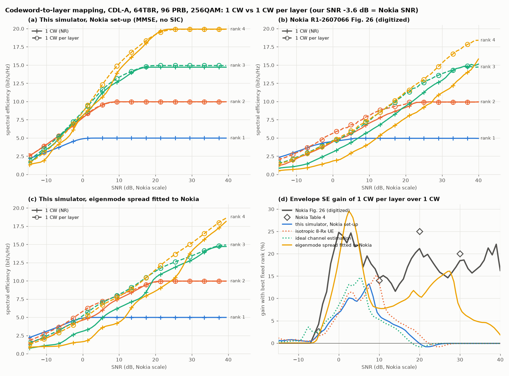
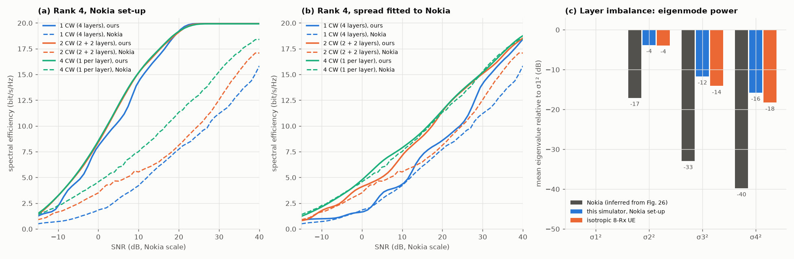

# Codeword-to-layer mapping: Nokia R1-2607066 without SIC

This study takes the link-level codeword-to-layer mapping (CW2LM) evaluation of Nokia R1-2607066 (RAN1 #126bis, section "Mechanism for layer mapping addressing layer imbalance") and repeats it in nrdlsim with Nokia's assumptions. It covers the 1 codeword per layer case (up to 4 codewords for 4 layers) and leaves out the SIC receiver.

Nokia's results without SIC that it compares against are:

| Nokia | Content |
|---|---|
| Fig. 26 | SE vs SNR, fixed rank 1–4, one codeword (NR) vs one codeword per layer, MMSE |
| Fig. 28 | rank 4: 1, 2 and 4 codewords (only the no-SIC curves are used here) |
| Table 3 | SNR of the rank transitions, single codeword (SCW) vs multi-codeword (MCW) |
| Table 4 | SE gain of MCW over SCW at −5 / 10 / 20 / 30 dB, envelope over ranks |

Nokia's system-level Fig. 29 uses a SIC receiver for both multi-codeword options, so it has no no-SIC counterpart and is not compared here.

```bash
python examples/cw2lm_nokia.py --drops 400      # ~2 min on 4 cores
python examples/cw2lm_nokia_plot.py             # re-plot results/cw2lm_nokia.json
python -m pytest tests/test_cw2lm.py
```

Files:

- `examples/cw2lm_nokia.py`: the study and the comparison metrics.
- `examples/data/nokia_r1_2607066_cw2lm.json`: Nokia's Fig. 26 and Fig. 28 curves, digitized.
- `results/cw2lm_nokia.json`, `.png`, `_rank4.png`: the last run.

## Set-up

The comparison uses Nokia's Table 11 (Annex B) assumptions. Items the contribution does not give are marked *assumed*.

| Item | Nokia Table 11 | Here |
|---|---|---|
| Carrier | 3.5 GHz TDD, 30 kHz, 40 MHz | 3.5 GHz, 30 kHz, 96 PRB (the figures use rb = 96) |
| Channel | CDL-A, DS 100 ns, 3 km/h | CDL-A, DS 100 ns; one slot per drop with ideal CSI, so the speed plays no role |
| gNB | 64 TXRU, 192 AE, (12,8,2,1,1;4,8), (d<sub>H</sub>,d<sub>V</sub>) = (0.5, 0.7) λ, polarization model 1 | 64 ports. Each TXRU drives 3 vertical elements at 0.7 λ with *assumed* electrical tilt 90°, so port rows are 2.1 λ apart. TR 38.901 element: 8 dBi, 65°, 30 dB. ±45° (polarization model 2, which is the same as model 1 at boresight) |
| UE | 8 Rx, TR 38.901 §7.3 (V19.1.0) directive antennas, (α,β,γ) = (0,0,0), no blockage | 8 single-polarized directive elements on the edges of a 15 × 7 cm handset, upright and facing azimuth 0, no blockage. Element 5.4 dBi, HPBW 125°, 22.5 dB. Element positions and pattern are *assumed* (see below) |
| Receiver | MMSE, SIC | LMMSE, no SIC |
| Channel estimation | non-ideal | DM-RS estimate of the precoded channel with error variance N0/6 per entry (*assumed*); the MMSE filter uses the estimate |
| Precoding | SU-MIMO | SVD per PRB (ideal CSI), equal power per layer (*assumed*) |
| Link adaptation | AMC | ideal AMC per codeword: the MCS with the most expected bits, TBS·(1−BLER), from MIESM and the LDPC waterfall |
| MCS table | Table 2 (256QAM) | Table 2 |
| Rank | fixed 1, 2, 3, 4 | fixed 1, 2, 3, 4 |
| Overhead | not given | 2 PDCCH + 2 DM-RS symbols = 120 RE/PRB; SE is normalised by the 96 PRB. MCS 27 then gives 4.94 bit/s/Hz per layer, close to the 5.0 per layer at which Nokia's curves saturate |

**Codeword-to-layer mappings.**
- **1 CW**: one codeword on all r layers (NR up to rank 4).
- **2 CW**: layers split {1,1}, {1,2} or {2,2}, smaller group first, as NR does for ranks 5–8.
- **1 CW per layer**: one codeword per layer.

Layers are in eigenmode order, so the 2-CW split puts the two strongest layers together. Each codeword gets its own MCS. `nrdlsim.layer_mapping.layer_groups` implements the split.

**UE handset model.** The Rel-19 UE antenna model of TR 38.901 §7.3 was not available offline. `nrdlsim.channel_models.ut_handset_array` builds it from memory of the model:
- Elements sit two per edge, with boresight perpendicular to the edge.
- They are numbered so that the 4-Rx subset (1,3,5,7) has one element per edge.
- Polarization alternates between θ and φ along each edge.
- The element pattern is the broad directional pattern used for the 7–24 GHz UE (5.4 dBi, 125°, 22.5 dB).

The model should be checked against the V19.1.0 text before it is used for anything other than this comparison.

**SNR axis.** Nokia does not define its SNR, so the two axes differ by a constant. The offset is set by matching our rank-1 curve to Nokia's rank-1 curve below 4.5 bit/s/Hz. Rank 1 has a single layer, so the codeword mapping cannot affect it. The fitted offset is −3.6 dB: our SNR − 3.6 dB = Nokia's SNR. All SNRs below are on Nokia's scale.

**Nokia's curves** were digitized from the figure images, with an accuracy of about ±0.15 bit/s/Hz. From the digitized curves, the rank transitions come out at 0.2 / 18.8 / 38.9 dB for SCW and −7 / 14.3 dB for the first two MCW transitions. The envelope gains come out at 4.2 / 14.5 / 21.2 / 18.4 %. This is consistent with Nokia's Tables 3 and 4 (0 / 19 / 38, −7 / 14 / 17; 2.6 / 14 / 25 / 20 %). The MCW 3→4 transition cannot be read from the digitized curves, because the rank-3 and rank-4 MCW curves overlap between 0 and 21 dB.

## Results (400 drops, MMSE, no SIC)





### Table 4 equivalent: best fixed rank, SE (bit/s/Hz) and gain of one codeword per layer over one codeword

| SNR | Nokia 1 CW | Nokia CW/layer | Nokia gain (Table 4) | Here 1 CW | Here CW/layer | Gain here |
|---|---|---|---|---|---|---|
| −5 dB | 4.01 | 4.18 | 2.6 % | 5.88 | 6.00 | 2.0 % |
| 10 dB | 7.03 | 8.05 | 14 % | 14.28 | 15.18 | 6.2 % |
| 20 dB | 9.36 | 11.34 | 25 % | 19.20 | 19.18 | −0.1 % |
| 30 dB | 12.90 | 15.28 | 20 % | 19.93 | 19.92 | −0.1 % |

The largest gain here is about 13 %, at 7 dB (panel d of the first figure).

### Table 3 equivalent: rank-transition SNR (dB)

| | 1→2 | 2→3 | 3→4 |
|---|---|---|---|
| Nokia, 1 CW | 0 | 19 | 38 |
| Nokia, 1 CW per layer | −7 | 14 | 17 |
| Here, 1 CW | −17.1 | −5.1 | 7.6 |
| Here, 1 CW per layer | −17.6 | −5.9 | 0.5 |

### Fig. 28 equivalent: rank 4, SE (bit/s/Hz) for 1 / 2 / 4 CW

| SNR | Nokia | Here |
|---|---|---|
| −5 dB | 1.14 / 2.45 / 3.35 | 4.69 / 5.48 / 5.57 |
| 10 dB | 4.21 / 5.53 / 7.51 | 14.28 / 15.15 / 15.18 |
| 20 dB | 7.74 / 8.13 / 11.34 | 19.20 / 19.11 / 19.18 |
| 30 dB | 11.20 / 12.54 / 15.28 | 19.93 / 19.93 / 19.92 |

### Sensitivity

Panel (d) of the first figure also shows two variants:
- An isotropic 8-Rx UE (2×2 dual-polarized, 0.5 λ) peaks at about 15 % gain at 9 dB and is 13.4 % at 10 dB.
- Ideal channel estimation peaks at about 15 % at 5 dB and gives 5.3 % at 10 dB.

Neither changes the picture. At 20 dB and above, the gain is zero in every variant.

## Why the gains here are smaller: layer imbalance

| Mean eigenvalue relative to σ1² (dB) | σ2² | σ3² | σ4² |
|---|---|---|---|
| Here, 8-Rx directive handset | −3.8 | −11.7 | −15.8 |
| Here, isotropic 8-Rx UE | −3.9 | −14.1 | −18.3 |
| Nokia, inferred from the Fig. 26 MCW curves | **−17** | **−33** | **−40** |

With SVD precoding the rank-r layers do not interfere, and layer k has SINR σk²·SNR/r. So the 1-CW-per-layer curves determine the eigenvalue spread directly. Nokia's rank-2 curve lies below rank 1 up to −7 dB and gains only 1.1 bit/s/Hz over rank 1 at 0 dB. This means their second layer is about 17 dB weaker than the first. Their rank-4 curve is still rising at 40 dB, which puts the fourth layer about 40 dB down.

In the CDL-A channel here, the sectored gNB element keeps mainly the dominant cluster group: clusters 2–4, at AOD −4°. Most other clusters leave at 80–180° from boresight and are attenuated by 20–30 dB. The ±45° gNB polarizations then give a second eigenmode within about 4 dB of the first. Making the UE co-polarized or isotropic, changing the TXRU tilt, or removing the sub-array changes σ2² by at most 2.5 dB. A single-polarized gNB moves it to −9 dB. No variant tried gets near −17 dB.

Two consequences follow.

1. **Low and mid SNR.** With σ2..σ4 within 16 dB, a codeword spread over all four layers loses only a little under MIESM. The rank-4 gain of one codeword per layer is 19 % at −5 dB and 6 % at 10 dB. Nokia's is 194 % and 78 %.
2. **High SNR.** All four layers here pass the 256QAM ceiling of about 25 dB SINR by 20 dB SNR. One codeword then runs MCS 27 on every layer, and per-layer adaptation has nothing left to gain. Nokia point out the same cap: the strongest layers reach the peak MCS. In Nokia's channel, the weak layers are still below the ceiling at 40 dB.

## Diagnostic: our model with Nokia's layer imbalance

To separate the channel from the codeword-mapping machinery, the variant `matched` keeps the same drops but scales eigenmodes 2–4 down by 13.25 / 21.25 / 24.0 dB. These values are fitted so that only the 1-CW-per-layer curves of ranks 2–4 match Nokia's. The fit uses ideal channel estimation, which makes the per-layer SE separable. The 1-CW and 2-CW curves are not fitted; they are predictions.

| | Here (`matched`) | Nokia |
|---|---|---|
| Rank transitions, 1 CW | 2.0 / 18.9 / 28.0 dB | 0 / 19 / 38 dB |
| Rank transitions, 1 CW per layer | −5.8 / 8.1 / 18.0 dB | −7 / 14 / 17 dB |
| Rank 4, 1 CW (bit/s/Hz) at −5 / 10 / 20 / 30 dB | 1.21 / 4.34 / 8.60 / 14.09 | 1.14 / 4.21 / 7.74 / 11.20 |
| Rank 4, 2 CW | 2.63 / 7.12 / 11.41 / 15.08 | 2.45 / 5.53 / 8.13 / 12.54 |
| Rank 4, gain of 4 CW over 1 CW | 174 / 82 / 34 / 8 % | 194 / 78 / 47 / 36 % |
| Rank 4, gain of 2 CW over 1 CW | 118 / 64 / 33 / 7 % | 115 / 31 / 5 / 12 % |
| Envelope gain, CW per layer (Table 4) | 1.7 / 7.8 / 10.5 / 7.9 % | 2.6 / 14 / 25 / 20 % |

With Nokia's imbalance, the single-codeword curves follow Nokia's up to about 15 dB. Specifically:
- The first two SCW rank transitions agree within 2 dB.
- Rank-4 SCW is within 0.15 bit/s/Hz up to 10 dB.
- The rank-4 gain of 4 codewords over 1 is of the same size at −5 and 10 dB.

The remaining difference is in **codewords that span layers with very different SINRs, at high code rate**:
- Our rank-4 SCW catches up with MCW above 25 dB, but Nokia's stays 20–30 % below it up to 40 dB.
- From 10 dB, our 2-CW curve sits close to the 4-CW curve, while Nokia's sits close to 1 CW.

MIESM credits a codeword with the mean mutual information of its layers. That is optimistic when the mean hides a weak layer under a 256QAM code at rate 0.7–0.93. Nokia's results presumably come from bit-true decoding. A further possibility is CQI-based AMC, whose CQI granularity would add to the loss. Either way, the loss is larger than MIESM predicts.

This explanation is not verified here. The bit-true LDPC path in nrdlsim uses a toy code: a random base graph without rate matching. It cannot test 256QAM codewords at rate 0.9. Checking the point needs an NR LDPC (TS 38.212 base graphs and rate matching), or an MIESM calibration factor for mixed-SINR codewords.

## Answer: do we observe similar results?

**Qualitatively, yes.** All of Nokia's directions are reproduced:
- One codeword per layer is never worse than one codeword.
- Its gain grows with rank and with layer imbalance.
- Two codewords sit between one and four at rank 4.
- Multi-codeword mapping moves the rank transitions to lower SNR. Here the 3→4 transition moves by 7 dB; Nokia's 2→3 and 3→4 transitions move by 5 and 21 dB.
- The gain disappears once every layer reaches the top MCS.

**Quantitatively, not with this simulator's own channel.** The CDL-A / 64T / 8-Rx handset modelled here has about 13 dB less spread between the first two eigenmodes than Nokia's results imply. The envelope gain is about 6 % at 10 dB and zero from 20 dB, against Nokia's 14–25 %.

**With Nokia's layer imbalance imposed**, the low- and mid-SNR results are reproduced. Our MIESM model still shows less multi-codeword gain at high SNR and for 2 CW than Nokia's.

So, without SIC, the size of the multi-codeword gain depends on the layer imbalance more than on anything else in the link. This agrees with Nokia's own point (Observation 36, Proposals 43–44): the UE antenna, blockage and channel assumptions must produce realistic imbalance, and companies should report the rank and per-layer SINR distributions. For the same reason, a system-level comparison is only meaningful once the UE antenna model is verified against TR 38.901 V19.1.0.

## Limitations

- **Nokia data.** Digitized from figures, ±0.15 bit/s/Hz. The SNR axes are aligned on rank 1.
- **Assumed models.** The handset UE geometry and element, TXRU tilt, CE error model, SVD precoding and overhead are assumptions where the contribution is silent.
- **Single slot per drop.** Ideal CSI, no CSI ageing or OLLA, ideal AMC, MIESM abstraction. The fixed-rank curves are therefore upper bounds on what each mapping achieves.
