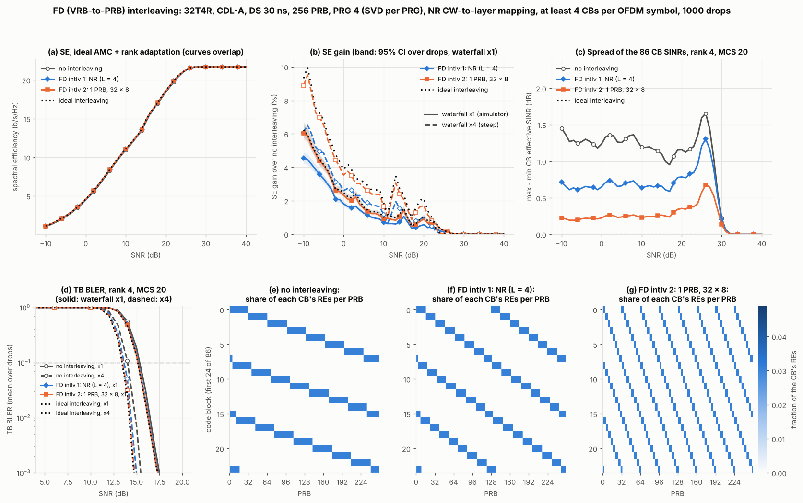

# Frequency-domain interleaving: 32T4R, CDL-A, DS 30 ns

This study compares two frequency-domain (FD), VRB-to-PRB, interleavers for a PDSCH that uses the whole bandwidth. It uses rank adaptation and the NR codeword-to-layer mapping. There are two set-ups:

| Set-up | Bandwidth | FD interleaving 2 | Code-block segmentation |
|---|---|---|---|
| 32 PRB | 32 PRB (11.52 MHz) | 4 × 8 block interleaver | NR |
| 256 PRB | 256 PRB (92.16 MHz) | 32 × 8 block interleaver | at least 4 code blocks in every OFDM symbol (C ≥ 44) |

The mappings compared are:

| Mapping | VRB-to-PRB mapping |
|---|---|
| no interleaving (reference) | PRB = VRB |
| **FD interleaving 1**: NR | TS 38.211 7.3.1.6 interleaved mapping with bundle size L = 4 and R = 2. VRB bundle j = 2c + r goes to PRB bundle C·r + c, with C = N_bundle / 2 (4 for 32 PRB, 32 for 256 PRB). At 32 PRB: VRBs 0–3 → PRBs 0–3, 4–7 → 16–19, 8–11 → 4–7, … At 256 PRB: VRBs 0–3 → PRBs 0–3, 4–7 → 128–131, … |
| **FD interleaving 2**: 1 PRB, R × C | VRBs are written row by row into an R × C matrix and read column by column: VRB v → PRB R (v mod C) + ⌊v/C⌋. At 32 PRB (4 × 8): VRBs 0–7 → PRBs 0, 4, …, 28; VRB 8 → PRB 1. At 256 PRB (32 × 8): VRBs 0–7 → PRBs 0, 32, …, 224; VRB 8 → PRB 1 |
| ideal interleaving (reference) | every code block sees the slot-average mutual information |

L = 4 is the only NR choice here: TS 38.211 does not allow L = 2 together with a PRG size of 4.

```bash
python examples/fd_interleaving.py                    # 32 PRB, 1000 drops, ~1 min on 4 cores
python examples/fd_interleaving.py --setup 256prb     # 256 PRB, 1000 drops, ~8 min on 4 cores
python examples/fd_interleaving_plot.py 256prb        # re-plot a saved result
python examples/fd_interleaving.py --ds 300 --drops 400 --no-plot   # cross-check
python -m pytest tests/test_fd_interleaving.py
```

Files:

- `examples/fd_interleaving.py`: the simulation, which writes `results/fd_interleaving.json` (32 PRB) and `results/fd_interleaving_256prb.json`
- `examples/fd_interleaving_plot.py`: the figures `results/fd_interleaving.png` and `results/fd_interleaving_256prb.png`
- `nrdlsim/re_mapping.py`: the VRB-to-PRB mappings and the RE mapping of code blocks
- `nrdlsim/ldpc.py`: `segment_transport_block` (TS 38.212 5.2.2, plus an optional minimum number of code blocks) and `rate_match_lengths` (5.4.2.1)
- `tests/test_fd_interleaving.py`

## Summary

- **32 PRB: no measurable gain.** Both interleavers improve spectral efficiency (SE) by at most 0.05 % (0.18 % with a steeper waterfall) and gain at most 0.06 dB at 10 % TB BLER. Over 11.52 MHz the beamformed channel is nearly flat, and every code block (CB) already covers at least ¾ of the band.
- **256 PRB with at least 4 CBs per OFDM symbol: a small but clear gain.**
  - **SE gain.** FD interleaving 2 (32 × 8) gains 0.9–2.3 % SE from 0 to 20 dB; FD interleaving 1 (NR) gains 0.6–1.8 %. With the steeper waterfall these become 1.7–3.5 % and 1.0–2.6 %.
  - **SNR gain at 10 % BLER.** 0.15–0.48 dB for 32 × 8 and 0.10–0.41 dB for NR, depending on rank and MCS. With the steeper waterfall these become 0.31–0.62 dB and 0.20–0.45 dB.
  - **Share of the ideal-interleaving gain.** The 32 × 8 interleaver gets about 90 % of it; NR gets about 65–70 %.
  - **Why NR gets less.** NR's 2-row interleaver only splits each CB into two contiguous halves of the band, whereas 32 × 8 spreads it over 8 chunks across the band.

## 32 PRB

**With this set-up, FD interleaving brings no measurable gain.** Both interleavers improve SE by at most 0.05 % with the simulator's LDPC waterfall, and by 0.18 % with a 4× steeper waterfall. At 10 % TB BLER they gain at most 0.06 dB. The ideal interleaver gains no more: there is almost nothing for any interleaver to recover. The link adaptation makes the same choices for every mapping: average rank within 0.005 and average MCS within 0.06.


### Why the gain is so small

Interleaving matters only when the code blocks (CBs) of a transport block (TB) see different SINRs. Two things keep them alike here:

1. **The beamformed channel is nearly flat over 32 PRBs.** The raw per-element channel |h|² of CDL-A at 30 ns varies by a median of 8 dB (7–10 dB, 10th–90th percentile) across the 32 PRBs. After per-PRG SVD precoding over 32 ports and the 4-Rx LMMSE receiver, the per-PRB SINR of each layer varies by a median of only 0.5, 0.7, 1.2 and 1.5 dB for layers 1–4 (90th percentile 0.9, 1.2, 2.1, 2.6 dB). These figures are at rank 4 and 25 dB over 200 drops.
2. **Each CB covers most of the band and all layers.** Layer mapping deals each CB's symbols out over all v layers, so layer imbalance is averaged inside every CB. The CBs are also long compared with the band. Even at rank 4, MCS 27 (TBS 125016, 15 CBs, the most CBs in this set-up), each CB covers 281–282 REs per layer, i.e. 0.73 OFDM symbol or about 23.5 of the 32 PRBs. At lower ranks a CB covers more than a whole OFDM symbol:

| Rank (MCS 27) | CBs per TB | REs per layer per CB | OFDM symbols per CB |
|---|---|---|---|
| 1 | 4 | 1056 | 2.75 |
| 2 | 8 | 528 | 1.38 |
| 3 | 12 | 352 | 0.92 |
| 4 | 15 | 281 | 0.73 |

Panels (e)–(g) of the figure show where each CB lands at rank 4, MCS 27. Without interleaving, each CB occupies one contiguous run of PRBs. The NR interleaver moves runs of 4 PRBs (one PRG) to the two halves of the band. The 4 × 8 interleaver spreads each CB over almost every PRG.

The spread (max − min) of the 15 CB effective SINRs shows how well each interleaver equalises the CBs. The table gives the drop average at rank 4, MCS 27; it is panel (c) of the figure:

| SNR | no interleaving | FD interleaving 1 (NR) | FD interleaving 2 (4 × 8) |
|---|---|---|---|
| 10 dB | 0.16 dB | 0.09 dB | 0.03 dB |
| 20 dB | 0.25 dB | 0.14 dB | 0.05 dB |
| 25 dB | 0.34 dB | 0.19 dB | 0.05 dB |

The 4 × 8 interleaver brings the CBs within 0.05 dB of each other and the NR interleaver halves the spread. Since the spread is only about 0.3 dB to begin with, neither changes the TB BLER enough to matter.

### Spectral efficiency (ideal AMC, rank adaptation)

The first data row is the SE without interleaving. The other rows are SE gains over no interleaving in %, with the 95 % bootstrap confidence interval over the 1000 drops (paired) in brackets.

Simulator waterfall (x1):

| | 0 dB | 5 dB | 10 dB | 15 dB | 20 dB | 25 dB | 30 dB |
|---|---|---|---|---|---|---|---|
| SE, no interleaving (b/s/Hz) | 5.14 | 8.25 | 11.59 | 15.63 | 19.23 | 21.60 | 21.70 |
| FD interleaving 1 (NR) | +0.01 (0.00..0.01) | +0.02 (0.01..0.02) | +0.01 (0.01..0.01) | +0.00 | +0.03 (0.02..0.03) | +0.01 (0.00..0.01) | 0.00 |
| FD interleaving 2 (4 × 8) | +0.01 (0.01..0.01) | +0.02 (0.02..0.02) | +0.01 (0.01..0.02) | +0.00 | +0.04 (0.03..0.04) | +0.01 (0.01..0.01) | 0.00 |
| ideal interleaving | +0.01 (0.01..0.02) | +0.02 (0.02..0.03) | +0.02 (0.01..0.02) | +0.00 | +0.03 (0.02..0.04) | +0.00 (−0.00..0.01) | 0.00 |

Steep waterfall (x4):

| | 0 dB | 5 dB | 10 dB | 15 dB | 20 dB | 25 dB | 30 dB |
|---|---|---|---|---|---|---|---|
| SE, no interleaving (b/s/Hz) | 5.86 | 9.31 | 12.92 | 17.24 | 20.77 | 21.70 | 21.70 |
| FD interleaving 1 (NR) | +0.02 (0.01..0.02) | +0.05 (0.04..0.06) | +0.02 (0.02..0.03) | +0.01 (0.01..0.01) | +0.13 (0.11..0.16) | 0.00 | 0.00 |
| FD interleaving 2 (4 × 8) | +0.02 (0.02..0.03) | +0.06 (0.05..0.08) | +0.03 (0.02..0.04) | +0.01 (0.01..0.02) | +0.18 (0.15..0.21) | 0.00 | 0.00 |
| ideal interleaving | +0.02 (0.02..0.03) | +0.07 (0.05..0.09) | +0.03 (0.03..0.04) | +0.02 (0.02..0.03) | +0.18 (0.15..0.22) | 0.00 | 0.00 |

- **Rank adaptation.** The average rank is 3.5 at 0 dB (48 % rank 3, 52 % rank 4) and 4.0 from 5 dB on, for every mapping. The 32-port array makes the 4th eigenmode strong enough for rank 4 almost everywhere.
- **Where the gain peaks.** The gains are largest around 20 dB, where the AMC uses MCS 24–26 at rank 4 with 14–15 CBs. From about 25 dB the TB sits at MCS 27 with near-zero BLER, so there is nothing left to gain.
- **The 4 × 8 interleaver.** At every SNR it is as good as NR or slightly better, and it essentially reaches the ideal reference. The difference from NR is at most 0.01 % of SE (x1) or 0.05 % (x4).

### TB BLER at fixed rank and MCS

The table gives the SNR (dB) at 10 % TB BLER, mean over drops, without interleaving, and how much lower (dB) the other mappings reach it.

| Rank, MCS (CBs) | waterfall | no interleaving | FD interleaving 1 (NR) | FD interleaving 2 (4 × 8) | ideal |
|---|---|---|---|---|---|
| 4, MCS 19 (11) | x1 | 14.83 | 0.00 | 0.00 | 0.00 |
| 4, MCS 23 (13) | x1 | 17.64 | 0.00 | 0.00 | 0.00 |
| 4, MCS 27 (15) | x1 | 23.23 | 0.02 | 0.03 | 0.03 |
| 4, MCS 19 (11) | x4 | 13.62 | 0.00 | 0.00 | 0.00 |
| 4, MCS 23 (13) | x4 | 16.32 | 0.01 | 0.02 | 0.02 |
| 4, MCS 27 (15) | x4 | 21.83 | 0.05 | 0.06 | 0.06 |

### Cross-check: a more frequency-selective channel

The set-up is unchanged except for the delay spread (400 drops). This check confirms that the model does see interleaving gain when the beamformed channel is selective.

| DS | Max SE gain, NR / 4 × 8 / ideal (x1) | Max SE gain, NR / 4 × 8 / ideal (x4) | 10 %-BLER gain at rank 4, MCS 27, NR / 4 × 8 / ideal (x4) |
|---|---|---|---|
| 30 ns (requested) | 0.04 / 0.05 / 0.05 % | 0.13 / 0.18 / 0.18 % | 0.05 / 0.06 / 0.06 dB |
| 100 ns | 0.03 / 0.03 / 0.04 % | 0.08 / 0.10 / 0.19 % | 0.01 / 0.00 / 0.04 dB |
| 300 ns | 0.15 / 0.11 / 0.36 % | 0.42 / 0.38 / 0.75 % | 0.03 / 0.28 / 0.89 dB |

At 300 ns, ideal interleaving gains up to 0.9 dB at rank 4, MCS 27. Neither interleaver gets close to that, and the 4 × 8 interleaver then shows a side effect of its geometry:

- **The 4 × 8 row index is the PRB's position inside its PRG.** VRBs 0–7 land on the first PRB of every PRG, VRBs 8–15 on the second, and so on. The NR interleaver keeps whole PRGs together.
- **Position inside the PRG matters once the channel varies within a PRG.** The per-PRG SVD precoder fits the PRG centre better than its edges. At 300 ns the edge PRBs (positions 0 and 3) are 1.5 dB worse than the centre PRBs (positions 1 and 2). A CB made of a few rows of the 4 × 8 matrix therefore sits mostly on edge PRBs, or mostly on centre PRBs.
- **At 30 ns the effect is negligible.** The edge–centre difference is 0.05 dB, so it does not affect the requested set-up.

## 256 PRB, at least 4 code blocks per OFDM symbol

The set-up is the same as for 32 PRB except for three changes:

- **Bandwidth.** 256 PRB (92.16 MHz), i.e. 64 PRGs of 4 PRBs.
- **FD interleaving 2.** A 32 × 8 block interleaver with 1-PRB granularity: VRB v → PRB 32 (v mod 8) + ⌊v/8⌋.
- **At least 4 CBs in every OFDM symbol.** The TB is segmented into C = max(C_NR, 44) code blocks: 4 per OFDM symbol times 11 data symbols. Each layer carries 11 × 3072 = 33792 data REs, so with C = 44 each CB takes exactly 768 REs per layer, ¼ of a symbol or 64 PRBs. With C > 44 it takes less.



### Where the minimum of 44 CBs applies

NR segmentation already gives at least 44 CBs at rank 4 from MCS 11, rank 3 from MCS 14 and rank 2 from MCS 21. Below that, and at rank 1 for every MCS, C is raised to 44, which is not NR.

| Rank | CBs per TB, MCS 0 → 27 | K′ at MCS 0 / 5 (forced 44 CBs) |
|---|---|---|
| 1 | 44 at every MCS (NR: 3–30) | 206 / 1166 bits |
| 2 | 44 up to MCS 20, then 45–60 | 386 / 2307 bits |
| 3 | 44 up to MCS 14, then 47–90 | 560 / 3471 bits |
| 4 | 44 up to MCS 11, then 49–119 | 748 / 4589 bits |

The forced CBs are short at low MCS. They get the shorter-block (shallower) waterfall of the BLER model, at their own code rate K′/E_r.

### Why the gain appears now

1. **The beamformed channel is selective over 92 MHz.** The raw per-element |h|² varies by a median of 25 dB (21–27 dB) across the 256 PRBs. After per-PRG SVD and LMMSE, the per-PRB SINR of layers 1–4 varies by a median of 2.4, 2.6, 2.8 and 3.5 dB (90th percentile 3.9, 4.1, 3.8, 4.8 dB). The 32-PRB figures were 0.5–1.5 dB. These are at rank 4 and 25 dB over 200 drops.
2. **Each CB covers at most ¼ of the band.** Without interleaving a CB sits on at most 64 contiguous PRBs (23 MHz).

Panels (e)–(g) of the figure show where the first 24 of the 86 CBs land at rank 4, MCS 20:

- **No interleaving.** Each CB sits on one contiguous run of PRBs.
- **NR (L = 4, R = 2).** Each CB is split into two contiguous chunks, one in each half of the band. A CB of 64 VRBs is 16 bundles; 8 of them go to each half.
- **32 × 8.** Each CB is spread over 8 chunks of 8 PRBs, 32 PRBs apart, across the whole band.

The spread (max − min) of the 86 CB effective SINRs, drop average at rank 4, MCS 20, is panel (c) of the figure:

| SNR | no interleaving | FD interleaving 1 (NR) | FD interleaving 2 (32 × 8) |
|---|---|---|---|
| 10 dB | 1.19 dB | 0.64 dB | 0.23 dB |
| 20 dB | 1.16 dB | 0.79 dB | 0.35 dB |
| 25 dB | 1.59 dB | 1.21 dB | 0.57 dB |

### Spectral efficiency (ideal AMC, rank adaptation)

The first data row is the SE without interleaving. The other rows are SE gains over no interleaving in %, with the 95 % bootstrap confidence interval over the 1000 drops (paired) in brackets.

Simulator waterfall (x1):

| | −5 dB | 0 dB | 5 dB | 10 dB | 15 dB | 20 dB | 25 dB | 30 dB |
|---|---|---|---|---|---|---|---|---|
| SE, no interleaving (b/s/Hz) | 2.33 | 4.48 | 7.57 | 10.97 | 14.55 | 18.44 | 21.27 | 21.69 |
| FD interleaving 1 (NR) | +3.32 (3.08..3.54) | +1.82 (1.68..1.97) | +1.27 (1.17..1.38) | +0.71 (0.64..0.79) | +1.07 (0.97..1.17) | +0.57 (0.52..0.64) | +0.13 (0.12..0.15) | 0.00 |
| FD interleaving 2 (32 × 8) | +4.11 (3.82..4.39) | +2.32 (2.15..2.50) | +1.54 (1.42..1.67) | +0.93 (0.84..1.01) | +1.40 (1.28..1.53) | +0.92 (0.84..1.00) | +0.24 (0.21..0.27) | 0.00 |
| ideal interleaving | +4.17 (3.87..4.44) | +2.47 (2.29..2.66) | +1.62 (1.50..1.75) | +1.02 (0.94..1.12) | +1.55 (1.43..1.68) | +1.10 (1.02..1.18) | +0.21 (0.18..0.24) | 0.00 |

Steep waterfall (x4):

| | −5 dB | 0 dB | 5 dB | 10 dB | 15 dB | 20 dB | 25 dB | 30 dB |
|---|---|---|---|---|---|---|---|---|
| SE, no interleaving (b/s/Hz) | 3.00 | 5.50 | 8.93 | 12.59 | 16.67 | 20.25 | 21.69 | 21.69 |
| FD interleaving 1 (NR) | +4.86 (4.49..5.22) | +2.61 (2.42..2.83) | +1.95 (1.75..2.14) | +1.17 (1.05..1.31) | +1.35 (1.23..1.49) | +0.96 (0.88..1.06) | +0.01 | 0.00 |
| FD interleaving 2 (32 × 8) | +6.55 (6.13..6.99) | +3.53 (3.29..3.80) | +2.81 (2.58..3.03) | +1.66 (1.50..1.81) | +2.08 (1.94..2.23) | +1.72 (1.61..1.83) | +0.01 | 0.00 |
| ideal interleaving | +6.86 (6.43..7.30) | +3.86 (3.61..4.14) | +3.10 (2.87..3.34) | +1.87 (1.71..2.04) | +2.35 (2.21..2.51) | +2.16 (2.03..2.28) | +0.01 | 0.00 |

- **32 × 8 vs NR.** Across the SNRs where ideal interleaving gains more than 0.1 %, the 32 × 8 interleaver gets a median 93 % of that gain (x1; 90 % for x4). NR gets 72 % (64 % for x4). Wherever there is a gain, 32 × 8 is ahead of NR: by at least 0.08 % of SE (x1) or 0.14 % (x4).
- **Low SNR.** The relative gain grows towards low SNR: 6.0 % for 32 × 8 at −10 dB, where SE is 1.06 b/s/Hz. In absolute terms the gain is larger at high SNR: about 0.17 b/s/Hz at 20 dB against 0.10 b/s/Hz at −5 dB. There SE grows almost linearly with SINR, so the same fraction of a dB is worth more percent.
- **Rank and MCS.** From 5 dB the average rank is at least 3.96 for every mapping. At 0 dB interleaving shifts the choice slightly towards rank 3: 44 % → 49 % with 32 × 8. Interleaving also lets the AMC pick a slightly higher MCS: on average +0.4 MCS at 0 dB and +0.2 at 20 dB for 32 × 8.
- **From 25 dB.** The TB sits at rank 4, MCS 27 with near-zero BLER, so there is nothing left to gain.

### TB BLER at fixed rank and MCS

The table gives the SNR (dB) at 10 % TB BLER, mean over drops, without interleaving, and how much lower (dB) the other mappings reach it.

| Rank, MCS (CBs) | waterfall | no interleaving | FD interleaving 1 (NR) | FD interleaving 2 (32 × 8) | ideal |
|---|---|---|---|---|---|
| 1, MCS 5 (44, forced) | x1 | −9.11 | 0.41 | 0.48 | 0.49 |
| 2, MCS 5 (44, forced) | x1 | −5.42 | 0.30 | 0.36 | 0.36 |
| 4, MCS 5 (44, forced) | x1 | −0.45 | 0.19 | 0.22 | 0.23 |
| 4, MCS 12 (49) | x1 | 6.35 | 0.14 | 0.17 | 0.18 |
| 4, MCS 20 (86) | x1 | 15.35 | 0.15 | 0.19 | 0.21 |
| 4, MCS 27 (119) | x1 | 24.47 | 0.14 | 0.22 | 0.27 |
| 2, MCS 27 (60) | x1 | 17.03 | 0.22 | 0.29 | 0.30 |
| 3, MCS 27 (90) | x1 | 21.05 | 0.10 | 0.15 | 0.17 |
| 2, MCS 5 (44, forced) | x4 | −6.66 | 0.45 | 0.62 | 0.65 |
| 4, MCS 5 (44, forced) | x4 | −1.69 | 0.26 | 0.38 | 0.45 |
| 4, MCS 12 (49) | x4 | 5.11 | 0.35 | 0.46 | 0.51 |
| 4, MCS 20 (86) | x4 | 14.03 | 0.39 | 0.56 | 0.62 |
| 4, MCS 27 (119) | x4 | 22.56 | 0.28 | 0.46 | 0.58 |
| 3, MCS 27 (90) | x4 | 19.33 | 0.20 | 0.31 | 0.40 |

With the steep waterfall the rank 1, MCS 5 curve is already below 10 % BLER at −10 dB, the lowest SNR simulated, so it is not listed.

## Model

| Item | Assumption |
|---|---|
| Carrier | 3.5 GHz, 30 kHz SCS, 32 PRB (11.52 MHz) or 256 PRB (92.16 MHz); the whole BWP is allocated |
| Channel | CDL-A, DS 30 ns, 3 km/h; one snapshot per drop (the channel is constant over the slot); 1000 drops |
| gNB | 32 ports, (M, N, P) = (2, 8, 2), ±45° cross-polar, 0.5 λ spacing, omni elements |
| UE | 4 ports, (1, 2, 2), ±45° cross-polar, 0.5 λ spacing, omni elements |
| Precoding | SVD per PRG of 4 PRBs: the strongest eigenvectors of Σ_PRG HᴴH, ideal CSI; equal power per layer |
| Receiver | LMMSE per subcarrier, ideal channel estimation |
| CW-to-layer mapping | NR: one codeword for ranks 1–4; symbol i goes to layer i mod v (TS 38.211 7.3.1.3) |
| PDSCH | 13 symbols, 2 DM-RS symbols (type 1, 2 CDM groups without data), so 11 data symbols: 132 RE/PRB, 4224 (32 PRB) or 33792 (256 PRB) RE per layer |
| Coding | TBS per TS 38.214 5.1.3.2, MCS Table 2. LDPC base graph, TB CRC and code-block segmentation per TS 38.212 7.2.2 / 5.2.2; E_r per CB per 5.4.2.1. At 256 PRB, C = max(C_NR, 44): each extra CB gets a 24-bit CRC, and K′ = ⌈B′/C⌉ |
| RE mapping | each layer frequency first over the VRBs, then symbol by symbol (TS 38.211 7.3.1.5), then VRB-to-PRB (7.3.1.6) |
| CB BLER | MIESM over the CB's REs, then the simulator's LDPC waterfall at the CB code rate K′/E_r and length K′ |
| TB BLER | 1 − Π (1 − BLER_CB) |
| Link adaptation | ideal AMC per drop and SNR: the rank (1–4) and MCS with the most expected bits TBS (1 − BLER_TB), chosen separately for each mapping |

The NR interleaver uses C = ⌊N_bundle / 2⌋ columns, which makes the mapping a permutation for every BWP size and offset (see the tests). With L = 4 there are 8 bundles at 32 PRB and 64 at 256 PRB, so C = 4 or 32 whichever rounding is used.

### Waterfall slope

How much the worst CB dominates the TB depends on how steep each CB's waterfall is.

- **x1 (all main results).** The simulator's waterfall (`link_abstraction._waterfall`), as in every other study in this repo. It is shallow: about 0.8 dB per BLER decade at K′ = 8448.
- **x4 (sensitivity check).** A 4× steeper slope with the same 50 % point, about 0.2 dB per decade at K′ = 8448. This is closer to an AWGN LDPC curve.

The conclusion holds for both.

## Limitations

- **Ideal CSI, ideal channel estimation, no CSI delay.** Precoder ageing or a codebook (Type I/II) precoder would leave more frequency selectivity in the effective channel, so these results lean towards the low side of the interleaving gain.
- **Ideal AMC.** There is no CQI mismatch, OLLA or HARQ. With a wideband CQI that cannot see CB-level effects, OLLA would absorb the small per-CB SINR differences as a back-off of a similar (tiny) size.
- **Full allocation only.** With a partial allocation inside a larger BWP, interleaving also spreads the allocated PRBs over the band, which is a different and usually larger effect.
- **Static channel within the slot.** At 3 km/h the channel does not change within the 0.5 ms slot, so CBs differ only in frequency.
